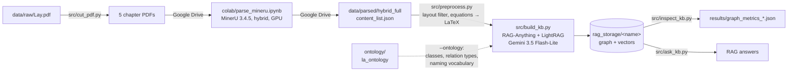

# Ontology-Guided Knowledge Graph Construction for a University Course

Master's thesis: a method for automatically populating the knowledge graph of a linear algebra course from a PDF textbook using a domain ontology, compared against a baseline (RAG-Anything without an ontology).

- Domain ontology: [la_ontology](https://github.com/sophiakoroliova/la_ontology)
- Corpus: Lay, Lay, McDonald, *Linear Algebra and Its Applications*, 5th ed., chapters 1–5 without applied sections (238 pages)

## Pipeline



Parsing is the only step that runs in Colab (it needs a GPU); everything else runs locally. The parsed corpus is produced once and reused by both configurations (baseline and ontology-guided).

## Repository layout

```
src/
  config.py         all settings: paths, corpus pages, models, rate limits, LightRAG parameters
  cut_pdf.py        cuts the corpus and chapter PDFs out of the full textbook
  preprocess.py     prepares MinerU output (layout filter, text-only mode)
  gemini_funcs.py   LLM / vision / embeddings via the Gemini API: rate limits, retries, token accounting
  build_kb.py       builds a knowledge base
  inspect_kb.py     structural graph metrics -> results/
  ask_kb.py         queries a knowledge base
  compare_kb.py     side-by-side table of graph metrics
  normalize_kb.py   post-processing: merge synonyms into canonical ontology names, fix types
  ontology.py       reads the domain ontology (classes, relation types, vocabulary)
  ontology_prompt.py  ontology-guided extraction: prompt section, entity types, domain example
  check_setup.py    checks the API key, models and data
ontology/           domain ontology files (from la_ontology), see ontology/README.md
colab/
  parse_mineru.ipynb  PDF parsing in Colab
tests/
  test_preprocess.py  offline tests (no API calls)
  test_ontology.py    offline tests of the ontology-guided method, incl. a gold-leakage check
  test_normalize.py   offline tests of the normalisation plan
  test_smoke.py       end-to-end run on chapter 3 (pytest --smoke, about $0.15)
run_all.py          the whole local pipeline in one command
data/               input data (not committed, see data/README.md)
results/            experiment metrics
```

## Reproducing the results

**Requirements:** Python 3.12 (MinerU 3.x does not support 3.14), a Gemini API key with billing enabled (Tier 1; free-tier limits are not enough), a Google account for Colab.

**1. Environment**

```powershell
git clone https://github.com/sophiakoroliova/thesis-graphrag.git
cd thesis-graphrag
py -3.12 -m venv venv
.\venv\Scripts\Activate
pip install -r requirements.txt
copy .env.example .env        # add your GEMINI_API_KEY
python src/check_setup.py
pytest                        # offline tests
```

**2. Corpus.** Put the textbook at `data/raw/Lay.pdf` and run `python src/cut_pdf.py`. This creates `data/pdf/chapters/lay_ch1.pdf … lay_ch5.pdf`.

**3. Parsing (Colab).** Upload the chapter PDFs to Google Drive under `Thesis_GraphRAG/pdf/chapters/`. Open `colab/parse_mineru.ipynb` in Colab, select a T4 GPU and click **Run all**. Then download `Thesis_GraphRAG/parsed/hybrid_full` from Drive into `data/parsed/hybrid_full`.

**4. Build the knowledge base and compute metrics**

```powershell
python run_all.py --text-only              # baseline, all chapters
python run_all.py --text-only --ask        # + sample questions
pytest --smoke                             # end-to-end pipeline check
```

## Baseline vs. proposed method

Both configurations share the same parsed corpus, chunking, models, LightRAG version (1.4.16) and retrieval settings. Only the extraction step differs:

| | Baseline | Ontology-guided (`--ontology`) |
|---|---|---|
| Entity types | LightRAG defaults (Person, Location, Event, Concept, Data, ...) | ontology classes: Concept, Theorem, Method, Example |
| Relation types | free-text keywords | first keyword is one of `requires`, `uses`, `broader`, `example_of`, `related_to` |
| Naming | free | canonical names from the ontology (with synonyms); no variable symbols or "Theorem 8"-style references |
| Prompt examples | LightRAG defaults (fiction, stock market) | one linear algebra example from outside the corpus (orthogonality, ch. 6) |
| Post-processing | none | `normalize_kb.py`: synonyms merged into the canonical name (e.g. Bases → Basis), ontology class enforced, leftover "Theorem N" references removed |

The ontology's own relations between elements are **not** given to the extractor: they serve as the gold standard for evaluating extracted prerequisites (`tests/test_ontology.py` checks that none of them leak into the prompt). The exact extraction prompt is saved next to each ontology-guided knowledge base (`extraction_system_prompt.txt`).

```powershell
python run_all.py --text-only --ontology       # proposed method, all chapters
python src/normalize_kb.py --run               # + normalisation -> rag_storage/ontology_norm_text
python src/inspect_kb.py rag_storage/ontology_norm_text
python src/compare_kb.py baseline_text ontology_text ontology_norm_text
```

## Pinned settings

| Component | Value |
|---|---|
| Parsing | MinerU 3.4.5, backend `hybrid-auto-engine`, language `en` |
| Knowledge graph | RAG-Anything + LightRAG 1.4.16 |
| LLM | `gemini-3.5-flash-lite`, temperature 0, default thinking (0 tokens) |
| Embeddings | `gemini-embedding-001`, dimension 768 |
| Insertion mode | `--text-only`: equations as LaTeX in the text, figures as captions, tables as text |
| Retrieval | `hybrid`, no reranking |

The `--text-only` mode was chosen for cost reasons: full multimodal processing of 1,234 equations and 160 figures requires several thousand extra LLM calls per knowledge base. Both configurations receive identical input. The full mode is available by omitting `--text-only`.

**On reproducibility.** Even at temperature 0, Gemini responses may vary slightly between runs, so the same code, versions and settings produce similar rather than bit-identical results. To reproduce the exact knowledge bases reported here, the LightRAG response cache (`rag_storage/*/kv_store_llm_response_cache.json`) is archived separately together with the experiment results.

## Current results

| Configuration | Entities | Relations | Entity types | Isolated | Build time | Cost |
|---|---|---|---|---|---|---|
| baseline (`--text-only`) | 1,142 | 1,635 | 13 | 154 (13%) | ~5 min | ~$1.50 |
| ontology-guided (`--text-only --ontology`) | 421 | 1,054 | 4 | 15 (3.6%) | ~5 min | ~$1.62 |
| + normalisation | 406 | 1,016 | 4 | 14 (3.4%) | < 1 min | < $0.01 |